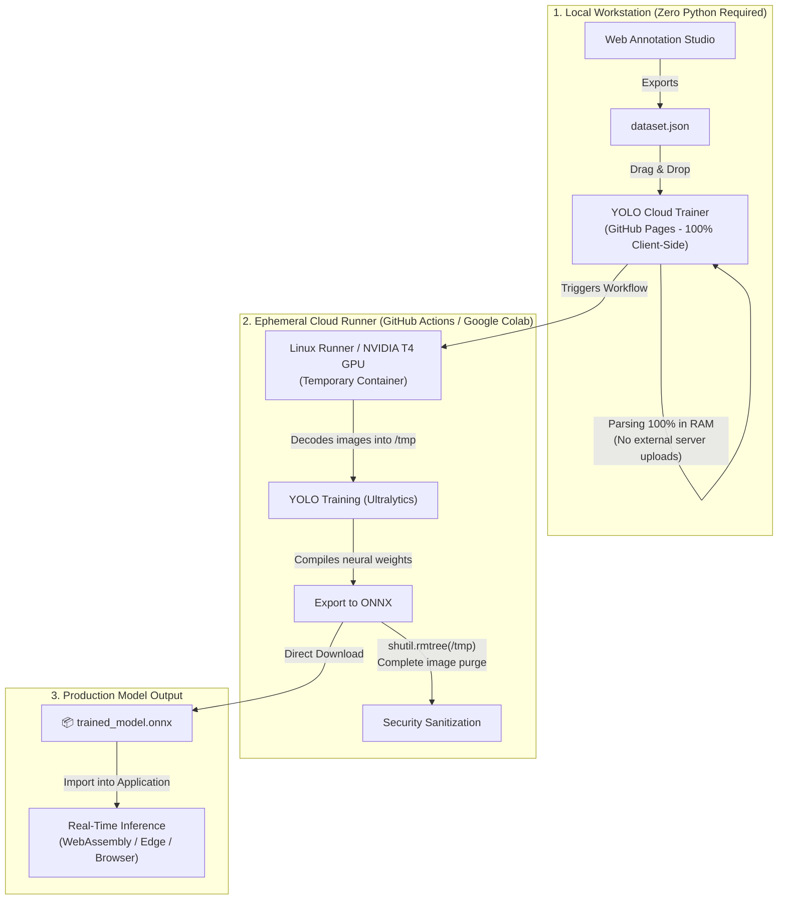

# 🚀 YOLO ONNX Cloud Trainer

> **Stateless Web Platform & Ephemeral Cloud Pipeline for Training YOLO Object Detection Models and Exporting to ONNX (WebAssembly Ready) with a Strict Zero-Data Retention Policy and Zero Local Python Dependency.**

[](./LICENSE)
[](#-privacy--zero-data-retention-guarantee-enterprise-compliance)
[](https://github.com/ultralytics/ultralytics)
[](https://onnxruntime.ai/)

---

## 🎯 Why This Project Exists

In strict corporate, industrial, and manufacturing environments, **installing or running Python on operator and workstation PCs is frequently restricted or forbidden** by corporate IT / SecOps governance policies.

Furthermore, photos of manufactured parts, assembly lines, and proprietary components carry **trade secrets, intellectual property, and strict regulatory requirements (GDPR/privacy)**, making it inadmissible to persist images on external third-party servers, unmanaged databases, or public Git commit histories.

This project solves both challenges:
1. **0% Local Python:** All computationally intensive training executes inside ephemeral, isolated cloud containers (GitHub Actions or Google Colab).
2. **Zero-Data Retention:** Images are never saved into databases or repository commit histories. They are decoded strictly in temporary volatile memory and **completely purged (`shutil.rmtree`)** before the cloud runner terminates.
3. **Exclusive `.onnx` Delivery:** The only output artifact produced for download is the compiled mathematical neural model (`.onnx`), ready for instant real-time inference in browser-based, Edge, or industrial applications via WebAssembly / ONNX Runtime.

---

## 🏗️ System Architecture



---

## 📁 Repository Structure

```text
yolo-onnx-cloud-trainer/
├── index.html                   # Complete Single-Page Application for GitHub Pages (100% Client-Side)
├── train_colab.ipynb            # Google Colab Notebook for 1-Click GPU T4 Training (~2 min)
├── LICENSE                      # GNU AGPL-3.0 License (fully compliant with Ultralytics YOLO)
├── README.md                    # Project documentation
│
├── .github/
│   └── workflows/
│       └── train.yml            # Automated GitHub Actions Cloud Training Workflow
│
└── scripts/
    └── train_cloud.py           # Ephemeral conversion and cloud training runner
```

---

## 🚀 How to Publish This Project on GitHub (Without Git Installed!)

If your corporate computer does not have Git installed, you can upload everything **directly through your web browser**:

### Step 1: Create the Repository on GitHub Web
1. Open [github.com/new](https://github.com/new) in your browser.
2. Enter a repository name (e.g., `yolo-onnx-cloud-trainer`).
3. Set the repository visibility to **Public** (required for free GitHub Pages and free GitHub Actions runner minutes).
4. Click **Create repository**.

### Step 2: Upload Files via Browser
1. On the initial page of your new repository, click the link **"uploading an existing file"** (or click *Add file* -> *Upload files*).
2. Select or drag-and-drop all files and folders from this directory into the browser window:
   - `index.html`
   - `train_colab.ipynb`
   - `LICENSE`
   - `README.md`
   - The `.github` folder (containing `workflows/train.yml`)
   - The `scripts` folder (containing `train_cloud.py`)
   > **Tip for browser upload:** You can drag the folders `.github` and `scripts` directly from Windows Explorer into the GitHub drop zone. Alternatively, use *Create new file* and type `.github/workflows/train.yml` in the file name box to create nested folders automatically.
3. Enter a commit message (e.g., `Initial commit`) and click **Commit changes**.

### Step 3: Enable GitHub Pages (Free Web Hosting)
1. In your GitHub repository, click the **Settings** tab.
2. In the left sidebar, click **Pages**.
3. Under **Build and deployment > Source**, select:
   - **Branch:** `main`
   - **Folder:** `/ (root)`
4. Click **Save**.
5. Within 1 to 2 minutes, GitHub will publish your live website URL:  
   `https://<your-username>.github.io/yolo-onnx-cloud-trainer/`

---

## 🏋️ How to Train Your Model in the Cloud

Choose between two completely free cloud methods:

### Option A: Via GitHub Actions (Automated CI/CD Pipeline)
1. Export your dataset JSON from your annotation studio.
2. In your repository ([github.com/bruno33223/yolo-onnx-cloud-trainer](https://github.com/bruno33223/yolo-onnx-cloud-trainer)), click **Add file > Upload files** and upload `dataset.json`.
3. **Automated Trigger:** GitHub Actions detects the dataset and launches training automatically! (Or trigger manually anytime via the **Actions** tab > **Run workflow**).
4. Wait for the run to finish (~15 minutes on standard CPU runner).
5. Download your compiled `.onnx` model from the **Artifacts** section!

### Option B: Via Google Colab (Free NVIDIA Tesla T4 GPU Acceleration)

[](https://colab.research.google.com/github/bruno33223/yolo-onnx-cloud-trainer/blob/main/train_colab.ipynb)

1. Click the **Open In Colab** badge above or open [train_colab.ipynb in Google Colab](https://colab.research.google.com/github/bruno33223/yolo-onnx-cloud-trainer/blob/main/train_colab.ipynb).
2. Click **Runtime > Run all**.
3. Select your exported `dataset.json` file when prompted by the upload widget.
4. Training completes in under 3 minutes on the free Tesla T4 GPU, and the `.onnx` model **automatically downloads to your PC**!

---

## 🔒 Privacy & Zero-Data Retention Guarantee (Enterprise Compliance)

This architecture was designed specifically to satisfy strict corporate IT, SecOps, and data privacy audits:

1. **Client-Side Only Execution:** All image previews, annotation bounding boxes, and metadata calculations occur strictly in the browser's volatile memory (RAM) via the HTML5 `FileReader` API. No photos are sent to external servers during browsing.
2. **Disposable Cloud Containers:** Training runs inside isolated, single-use virtual machine instances provisioned on-demand by Microsoft Azure / GitHub Actions / Google Cloud.
3. **Automated Sanitization:** Before the virtual machine shuts down, the script triggers a programmatic purge (`shutil.rmtree`) removing all decoded images and dataset files.
4. **Zero Images in Git History:** No raw photos or proprietary parts are committed to Git version control.
5. **Pure Mathematical Model Output:** The only deliverable is the compiled neural weights file (`.onnx`), containing purely mathematical tensor coefficients without raw image data.

---

## ⚖️ License

This project is licensed under the **[GNU Affero General Public License v3.0 (AGPL-3.0)](./LICENSE)**, guaranteeing full legal and technical compliance with **Ultralytics YOLO** open-source terms.
